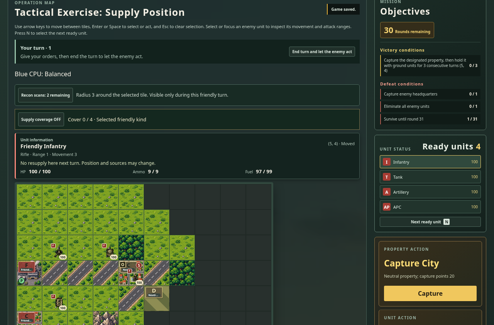
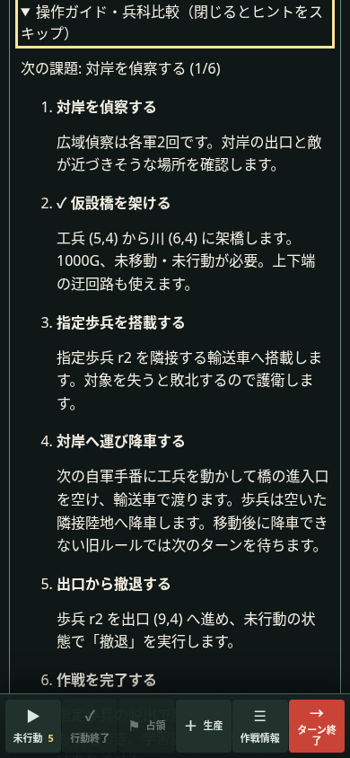

# v1.4.7 比較・確認記録

## 範囲

Issue #264の承認された3項目：初回・復帰の応答改善、戦術単体作戦の小規模拡充、CPUの条件を絞った比較。製品実装前にドラフトPR #265を作成した。

- 画面外サムネイルのSVG生成・挿入を近傍まで遅延し、固定の高さでレイアウトを保持する。旧画面のobserverとコールバックは破棄する。IntersectionObserver非対応環境は即時描画する。
- 閉じたガイドは兵科表を生成しない。開いたガイドの進捗は既存のBattleHistoryによる合法な履歴の走査と同時に収集する。新たに履歴全体を毎描画でリプレイしない。
- 2作戦を追加する。課題は任意で、既存の勝利条件を使う。占領は所有色の変更、補給は実残量の回復、輸送は同じ自軍の搭載と降車を確認する。指定歩兵は対象IDの履歴を確認する。

## 互換性

v1.4.6の24定義（基本操作練習を含む）のcanonical JSONをSHA256で固定し、全件一致を回帰テストにした。新作戦は末尾に追加する。既存キャンペーン経路・日替わり生成・保存形式・戦闘規則に変更はない。保存・リプレイから課題を再構成し、履歴の巻き戻し時は将来の達成を残さない。

## 計測

生データは [v1.4.7](v1.4.7/) に保持する。製品ソースは `765b4c49aa4795d9aea50fe56dfce94d99cd9811` で固定し、以後は証跡・集計・テストの修正のみ。詳細は [sources.json](v1.4.7/sources.json)。ローカルのネットワークではnpmレジストリが許可されないため、クリーンインストール・最新監査・正式依存バージョンの判定はCIで行う。手元のWebKitには必要なシステムライブラリがないため、ネイティブCI上で変更前後を測定する。

## CPU限定比較（確定）

`cpu-limited-v147.mjs`は結果を見る前に固定した5条件を各往復で実行する。通常CPU同士、守勢／攻勢を交換、統合戦術、改訂配置、後攻+2000G、90ラウンド上限（マップ固有の早い判定は優先）。未使用seedは `v147-hold`／1473。変更前10戦、変更後10戦を完走し、全件で勝敗・ターン・行動数・commandDigest・修理／補給を含む全metricsが一致した。

| 条件 | seed／damage | 往路 | 復路 |
| --- | --- | --- | --- |
| 32内陸・既知 | v146-final／1466 | 攻勢・後攻勝ち T61 | 攻勢・先攻勝ち T61 |
| 32沿岸・既知 | v146-hold／1461 | 攻勢・後攻勝ち T61 | 守勢・後攻勝ち T61 |
| 20沿岸・対照 | v146-hold／1461 | 守勢・先攻勝ち T39 | 攻勢・先攻勝ち T61 |
| 32内陸・未使用 | v147-hold／1473 | 攻勢・後攻勝ち T47 | 攻勢・先攻勝ち T56 |
| 32沿岸・未使用 | v147-hold／1473 | 守勢・先攻勝ち T61 | 守勢・後攻勝ち T61 |

修理経路の採用は前回のroute-only切り分けで既知条件の勝敗変化と結び付いているが、今回の比較から機能不良や単一の原因は確定できない。守勢は修理と戦線・目標の保持を両立する課題を残す。AIの重みやマップを変えてこの固定条件だけに合わせることはせず、CPUの判断はv1.4.6を保持する。

守勢4勝／攻勢6勝、先攻4勝／後攻6勝は相関した固定往復の内訳で、全般的な強さや公平性の推定ではない。補給切れ回数は対局長・部隊数に依存し、総量から効率向上を判断しない。問題条件を再現する比較セットと生データを成果とし、回復と目標保持の競合の最小化・採否はIssue #264に継続する。


## 応答計測の条件

同じharness `cdde3ab8860ad02bfd0f16abad114a2e20cb6da1a12ec641758e6d04ea267f50`、同じホスト・ブラウザー・ビルドツールで変更前後を交互に3組測定した。毎回新しいコンテキストを使い、1280幅32盤面・390幅32盤面・390幅16盤面を比較。実在する自軍戦車2部隊を交互に25回選択し、選択マーカーを確認した。CPU観戦や他のテストは同時実行しない。

- 初回はページ遷移から最初のタイトルカードが操作可能になる時間と、そのカードのSVGが表示されて2フレーム待つ時間を別々に記録。後者は画像復号完了を分離した専用計測ではない。
- handler時間と2フレームまでの待機を分け、最初の選択3件と連続選択72件を分ける。タイトルを表示して描画を待ってから再開する。
- ブラウザー自体の準備は空のドキュメントで別計測する。アプリの待機上限は30秒で、retry／skip／絶対時間の合格基準を追加しない。
- p50は中央値、p95はnearest rank。初回などn=3のp95は最大値であり、安定した裾の推定ではない。連続選択も同一コンテキスト内で相関する。物理端末のタッチ遅延や全負荷の結果へ一般化しない。

### ローカル（既存ツール）

Node 24.19.0、Vite 6.4.3、Vitest 3.2.7、TypeScript 5.9.3、Playwright 1.62.1。Chromium 151／Firefox 153。正式依存の測定とは混ぜない。数値はms、変更前→後。

| Engine／幅・盤面 | 初回SVG p50 | タイトル表示 p50 | 再開 p50 | 初回選択handler p95 | 連続handler p50／p95 |
| --- | --- | --- | --- | --- | --- |
| chromium／1280・32 | 680.0→486.8 | 115.1→52.0 | 90.5→66.6 | 65.0→53.0 | 27.8→25.8／32.6→32.9 |
| chromium／390・32 | 505.1→343.2 | 128.6→66.5 | 104.9→83.4 | 52.4→53.2 | 44.3→40.0／58.6→53.5 |
| chromium／390・16 | 552.7→356.9 | 148.3→67.2 | 73.1→66.0 | 50.4→45.1 | 40.5→37.8／52.0→56.6 |
| firefox／1280・32 | 726.0→689.8 | 127.0→77.0 | 89.0→74.0 | 49.0→55.0 | 33.0→30.0／43.0→36.0 |
| firefox／390・32 | 437.8→287.4 | 111.0→39.0 | 63.0→50.0 | 55.0→62.0 | 31.0→28.5／44.0→36.0 |
| firefox／390・16 | 410.7→328.5 | 111.0→39.0 | 46.0→34.0 | 49.0→49.0 | 27.0→26.0／33.0→35.0 |

[生データ](v1.4.7/response-local/)・[全指標](v1.4.7/response-local-summary.json)。390幅32盤面のChromium連続handlerで50ms超は23/72→10/72。16盤面の連続p95はChromium52.0→56.6、Firefox33.0→35.0、32盤面の最初の選択最大値も一部悪化している。タイトルの生成量を減らす修正として採用し、すべての操作が速くなったとはしない。

### ネイティブCI（正式依存）

[成功run 42063112793](https://github.com/kumakumapon/MiniStr/actions/runs/42063112793)／head `573236c6bc69edca51a6ae1a3f986ae22c6ab20d`。チェックアウトされたPRのmerge buildは `4bc043a4a904`。基準は正式v1.4.6の同一ツール再ビルド。クリーンinstallでVite 8.3.5／TypeScript 6.0.3／Playwright 1.64.1を利用。Node 24.22.1／npm 11.9.0、Ubuntuの同じrunner上で3エンジンを順番に測定した。Chromium 156.0.8078.4／Firefox 157.0／WebKit 27.2。

| Engine／幅・盤面 | 初回SVG p50 | タイトル表示 p50 | 再開 p50 | 初回選択handler p95 | 連続handler p50／p95 |
| --- | --- | --- | --- | --- | --- |
| chromium／1280・32 | 396.1→329.8 | 81.3→32.4 | 50.0→50.6 | 31.5→33.8 | 17.0→17.0／20.5→24.9 |
| chromium／390・32 | 337.4→211.3 | 83.2→50.0 | 66.6→49.7 | 48.7→38.6 | 21.2→19.5／32.7→31.4 |
| chromium／390・16 | 338.5→205.6 | 66.7→61.2 | 48.8→23.2 | 37.0→34.5 | 20.5→19.4／29.3→28.1 |
| firefox／1280・32 | 680.6→587.9 | 108.0→72.0 | 63.0→60.0 | 43.0→43.0 | 24.0→23.0／29.0→30.0 |
| firefox／390・32 | 360.2→234.2 | 96.0→34.0 | 46.0→49.0 | 42.0→43.0 | 24.0→23.0／29.0→28.0 |
| firefox／390・16 | 371.2→240.9 | 89.0→26.0 | 44.0→33.0 | 41.0→37.0 | 21.0→20.0／26.0→24.0 |
| webkit／1280・32 | 933.2→897.3 | 262.0→195.0 | 195.0→178.0 | 67.0→63.0 | 38.0→36.0／42.0→40.0 |
| webkit／390・32 | 711.8→559.8 | 172.0→113.0 | 161.0→129.0 | 70.0→61.0 | 39.0→38.0／45.0→41.0 |
| webkit／390・16 | 713.8→560.1 | 166.0→107.0 | 130.0→113.0 | 71.0→53.0 | 31.0→29.0／35.0→33.0 |

[生データ](v1.4.7/response-native/)・[全指標](v1.4.7/response-native-summary.json)。WebKit390幅32盤面の連続handlerの50ms超は1/72→0/72、1280幅32盤面は1/72→1/72。初回SVG・タイトル表示の中央値は全9条件で短縮したが、Firefox390幅32盤面の再開は46→49ms、PCの一部連続p95も悪化した。

タイトルの初回DOMは、カスタム計測用カード1件を含み、変更前24カード／24プレビュー／5088要素（32盤面条件）。変更後は新作戦2件を含む26カードでも、1280幅で8プレビュー／2178要素、390幅で2プレビュー／769要素（ローカルでは3／944）。閉じた比較表は18行→0行。画面外の生成削減と整合する。既存の地形色比較も維持し、下へスクロールした全カードの表示、固定高さ、戻ったカードへのキーボードフォーカスを確認する。

## 検証と失敗履歴

- ローカル全単体1546件・coverage gate、配布UI61件、型・lint・整形・リンク・公開条件テストが成功。旧ツールでの結果であり、正式依存での判定はPRのCIで行う。
- 既存24定義の固定ハッシュ、2新作戦の合法な攻略・全任意課題・保存／リプレイ・履歴の巻き戻しを検証。赤のnormal／hard CPUも初期配置からeasy CPU相手に両作戦を達成できた。新作戦は学習用の非対称配置で、競技的な先後公平性の対象ではない。
- PC／390幅・日英・タイトル／新作戦／保存再開はChromium／Firefoxで27件成功。英語占領表示を追加修正した最終製品ビルドでも4件を再確認した。
- 最初のブラウザ確認で保存再開後に案内が閉じる問題を検出し、新作戦の再開時に開くよう修正。統合テストとブラウザテストに残した。
- 追加したLearningLogの初期テスト2件は、指定部隊を除いたfixtureが撤退目標の自動敗北条件を満たしていた。目的に合う勝利条件にfixtureを修正し、合法なコマンド列を確認した。
- 正式CI初回 `42062105393` は、TypeScript 6で可変状態の型が狭く推論されて失敗。GameStateを明示し、後続のNode22.13検証が成功した。
- Firefoxのローカル基準ポート4190は制限対象で、ナビゲーション割り込みにより2回停止した。計測CI初回 `42062105617` も同じ理由で停止した。基準を4192へ変更して全組完走。旧失敗回を成功サンプルへ混ぜていない。CIも4192とstrictPortを使用する。
- 占領欄の英語検査は、部隊行動欄にも同じCSSクラスがありstrict locator違反で一度停止した。占領ボタンを含む欄を指定して再実行し成功。検査対象や言語基準は維持する。
- CI `42065461958` の音声先行検証でWebKitが30秒を消費した。失敗traceでは最初の `newPage` が21.75秒、ページ遷移が2.97秒で、アプリ操作前の生成に時間がかかっていた。音声検証にも既存のworker単位の起動準備を適用し、空のドキュメントだけで準備を確認する。実アプリは新しいコンテキスト、従来の30秒上限・検査内容・retryなしを保持する。ゲーム本体や音声コードは変更しない。

最終コミットを含むクリーンinstall・最新監査・coverage・Node22.13・配布UI・全3ブラウザー・地形33回・CodeQLの結論は、[PR #265 Checks](https://github.com/kumakumapon/MiniStr/pull/265/checks) と [Issue #264](https://github.com/kumakumapon/MiniStr/issues/264) に集約する。既存の品質ゲート・反復数・時間制限・色差・権限・公開条件は緩和していない。

## 画面例





## 再現と残範囲

`npm ci`後、基準版と候補版を同じツールでビルドし、それぞれlocalhost4192／4191でpreviewする。`response-comparison.yml`は同じ順序をCIで実行し、証跡を保存する。

```sh
node scripts/browser-response-v147.mjs http://127.0.0.1:4192 before.json before 0 webkit
node scripts/browser-response-v147.mjs http://127.0.0.1:4191 after.json after 0 webkit
node scripts/response-summary-v147.mjs docs/reviews/v1.4.7/response-native summary.json
node scripts/cpu-limited-v147.mjs /path/to/baseline cpu-before
node scripts/cpu-limited-v147.mjs /path/to/candidate cpu-after
```

完全な往復はrawのファイル名どおり、0・2組をbefore→after、1組をafter→beforeとする。集計は各engine6ファイル、各条件3件・選択25件、単一harnessを必須とし、途中終了した回は拒否する。不足した組・異なるharness・欠けた選択数の3つの不正入力も、出力せず失敗することを確認した。

実機・VoiceOver・数時間のメモリ計測、CPUの回復と目標保持の競合の最小fixtureへの縮小、別倍率・密集部隊・追加seedの評価はIssue #264で継続する。今回の比較を全マップの公平性・全ブラウザーの速度保証へ一般化しない。
