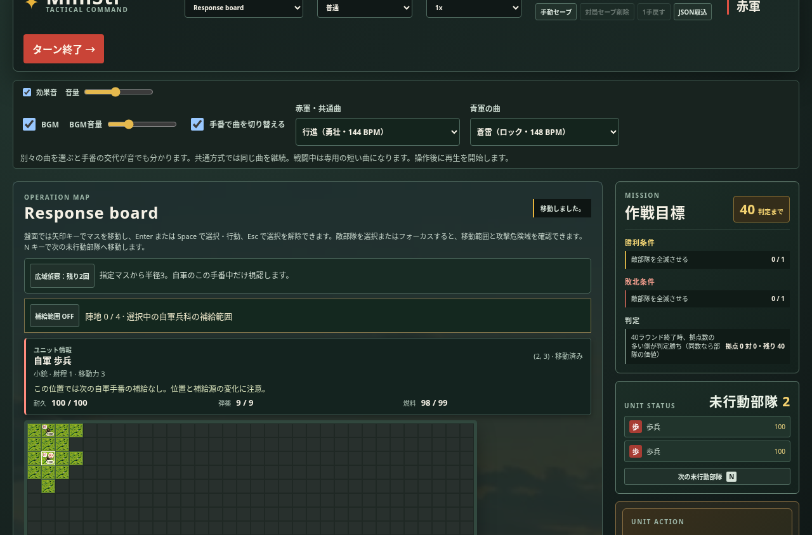
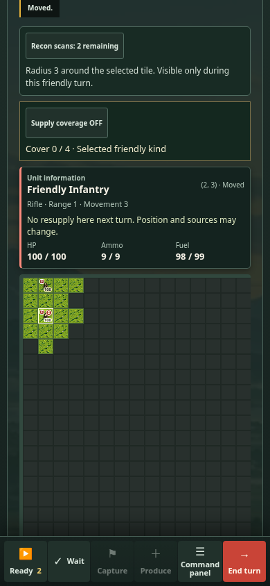

# v1.4.9 CPU沿岸条件・初回選択／復帰の表示待ち

2026-11-06 JST。製品変更前に計画のみのドラフト [PR #267](https://github.com/kumakumapon/MiniStr/pull/267) を作成し、公開済みv1.4.8を基準に実装・比較した。版番号と公開ノートを1.4.9へ同期した。マージ・タグ・正式公開は別の段階である。

## 比較基準と採用内容

- 基準は公開済みv1.4.8。基準treeは `28491d6d7ccf00d94dbb013fdaac74108c6d5c40`。
- 正式な基準SHA：`ad4b900ff2fa645cf39f89141b55a0bd301443a8`。ローカルの同一tree `20c1c7b8aa3da4b1aa31cfa3372514aa6eabc37d` と区別する。
- CPUは修理中の地上間接射撃部隊の展開判断を限定修正。既知の沿岸復路の悪化を、合法な共通prefixと1命令だけを変えた継続で切り分けた。
- 表示は、接続したままのスクロール容器・画面位置の不要な書き戻しと、同じ要素への重複focusを省いた。キーボード移動、差し替え後の復元、倍率・タイトル復帰を維持する。
- ゲーム規則・マップ配置・保存／リプレイ形式・依存ライブラリは変更していない。`src/game` の本番ソースSHA256は前後とも `8709d53a5d31444cecb73bd43e506ff62a85fd4063197f26264403e59da967fd`。

ソースの完全SHA・tree・ファイル別／群別hash・harness hashは [source-metadata.json](v1.4.9/source-metadata.json)。CPU比較用source digestは基準 `6f712926a804cb12eb27b0848b2bf243a52077d341eef4f5e7a602a71cef5e23`、採用案 `783c2d3e830060634ebefc5d72f0ca8df53a9385cacb8c37eeca61ae235875b7`。CPU・UI・ゲーム規則を区別し、異なるローカル／remote commitを同じ履歴とは扱わない。

## CPU：問題局面の再現と切り分け

32沿岸 `v146-hold`／damage1461、通常同士・守勢対攻勢・統合戦術・改訂配置・後攻+2000Gの復路。公開版との最初の分岐は共通1,290命令後の **T34青、u41砲兵HP42、自軍都市(9,12)**。座標は0始まり。

初期配置から全prefix命令を合法に適用し、固定stateのSHA256 `ceef53f8959533567215cfccbe0d12a910d4ff4108c6b7dc569b373a4859bdea` と一致することをharnessで検証する。v1.4.8は有料修理を優先して待機していた。最初の命令だけを従来の有効な移動(12,13)に差し替え、その後は同じv1.4.8の判断で続ける比較を行った。

| 継続 | 最初の命令 | 決着 | 総命令数 | 全行動列digest |
| --- | --- | --- | ---: | --- |
| v1.4.8通常 | u41待機 | T61赤勝利 | 2,261 | `da5cd507efbce0c5a2ad9c93683f02bc66d9dd8e0d2063c681ab89c7c7b991fe` |
| v1.4.8・1命令だけ強制 | u41移動(12,13) | T61青勝利 | 2,271 | `9ac9b78548e6dd76df70cb3e32cec3f23d9fe73c3da818b0e864b093de82dddc` |
| 採用案・通常判断 | u41移動(12,13) | T61青勝利 | 2,271 | 同上 |

採用案は強制命令を使わず同じ行動を選び、以後の全行動列も1命令差し替えの結果に一致した。これは同じ合法局面からの反実仮想比較で、独立した新規3対局や全マップの公平性の証明ではない。配置・地形・目標は固定しており、マップ配置変更の必要性／効果は今回判定していない。

### 採用した判断と保護

HP36〜49の準備済み地上間接射撃部隊について、通常の位置評価が修理地点より良い移動先を選び、現在は撃てず、展開後の次の手番に既知の敵を主武器で撃てる場合に移動を許す。移動した手番に間接射撃できるようにはしていない。修理価値を含む既存の位置評価をそのまま使い、勝者に合わせた重み・seed分岐は追加していない。

- HP35以下、司令部、実際の保持地点、今いる場所からの攻撃、弾切れ、行動済み、艦砲、旧ルールを保護する。
- 候補位置で、現在視認している敵からの最大予測損害合計が現在HPに達する案は除く。将来の敵移動や未知の射撃まで安全を保証する判断ではない。
- 投影では自軍と現在の既知敵IDだけを使う。移動先で増える仮の視界を使って未発見の敵を先読みしない。入力stateを変更しない。
- 両軍、合法な移動→次手番の射撃、保持・重傷・現在射撃・未知敵・司令部／艦砲・決定性・不変性を7件の単体テストで確認した。既存の回復経路11件・保持交代10件も成功。

### 対局比較：変更前後各26戦

基準11条件22戦を先に固定し、判断を凍結した後で未使用 `v149-hold`／1491の32内陸・沿岸各往復4戦を追加した。同じharness・同じ規則・同じ配置を使い、90ラウンド・1手番120命令・1局25,000命令の上限を維持。全52対局が合法に完走し未決着なし。既知22戦の基準側は、公開v1.4.8の全行動列と全metricsを再現した。

| 集計 | v1.4.8 | 採用案 |
| --- | ---: | ---: |
| 基準22戦の守勢／攻勢勝利 | 9／13 | 10／12 |
| 未使用4戦の守勢／攻勢勝利 | 1／3 | 1／3 |
| 全26戦の守勢／攻勢勝利 | 10／16 | 11／15 |
| 全26戦の赤先攻／青後攻勝利 | 15／11 | 14／12 |

勝者が変わったのは問題の沿岸復路1戦。その他25戦の勝者は同じで、全26戦中24戦は行動列digestも一致した。未使用4戦は全行動列・全metricsが一致しており、新規条件での効果があったとは扱わない。往復は配置回転・方針交換による相関があり、作戦目標も非対称なため、この集計を一般的な勝率・先後公平性へ一般化しない。

#### 行動列が変わった2戦の指標

問題の沿岸復路は両版T61。初回目標到達、初占領・中立収入、初生産・増援到着時期は同じだった。

| 沿岸復路の指標 | v1.4.8 | 採用案 |
| --- | ---: | ---: |
| 青の損失価値（赤の撃破価値） | 411,000 | 397,000 |
| 赤の損失価値（青の撃破価値） | 326,000 | 311,000 |
| 青の修理費／回復HP | 11,600／280 | 18,600／500 |
| 青の主武器補給弾数／燃料純増 | 54／1,098 | 55／1,254 |
| 青の終局拠点数／収入／資金 | 9／7,000／6,400 | 10／8,000／9,400 |
| 赤の終局拠点数／収入 | 9／7,000 | 8／6,000 |

対象u41は両分岐とも終局までには失われるため、対象砲兵の生存改善とは主張しない。1回の展開が後続の修理・占領・他部隊行動へ波及した結果であり、全指標が改善したわけではない。赤の燃料切れ開始は3→6となった。

もう1戦は32内陸 `v148-hold`／1481往路。青勝利・T61を維持し、命令数2,166→2,122。赤の修理費は13,570→18,490、赤の回復HP253→301、青の回復HP50→13、青の燃料切れ開始15→8、赤は0→2。赤／青の与損害価値は244,730／308,600→242,490／299,050、青の撃破価値298,000→283,000。勝者だけで副作用を隠さず、[cpu-summary.json](v1.4.9/cpu-summary.json) と全生データへ記録した。CPU時間は他の作業と重なる測定を含む診断値で、速度改善の根拠には使わない。

## 表示：原因と採用案

Chromiumのtraceとscroll／focus呼出し計測では、復帰時のページscrollToと重複focusの近くでスタイル計算・レイアウトが発生した。保持した盤面にも座標を書き戻す経路があった。

- 保持したmainと盤面viewportではCSSのスクロールアンカーを使わず、ページ位置を保持する。同じ接続済み容器には保存位置を書き戻さない。
- 差し替えられたページ・容器は従来どおり復元する。タイトル復帰ではDOM変更前にviewport・倍率・座標を確認し、保持できている場合だけ書き戻しを省く。DOM書込後の新たなgeometry読取を加えない。
- 同じ要素がアクティブな場合はnative focusを再度呼ばない。必要な別要素へのfocus、キーボード／ズームの対象表示、overlayの世代・ユーザー操作guardは維持する。

### 原因調査用trace

同じ詳細harnessによるChromium151のPC32／390幅16／390幅32を記録。復帰のスタイル計算合計は166.8→18.7／100.4→8.1／120.6→15.8ms。初回選択の最初のmain-thread Paintは122.0→92.5／112.5→78.2／104.1→76.9msだった。

このharnessは関数wrapperと詳細invalidations追跡を含み、計測負荷が大きい。上記は原因調査の値であり、通常利用時の速度や採用効果の絶対値とは扱わない。main-thread PaintはGPUへの提示完了ではない。[profile-before.json](v1.4.9/profile-before.json)、[profile-candidate-a.json](v1.4.9/profile-candidate-a.json)、[圧縮trace全6本](v1.4.9/traces/) を保存した。初期の別harnessによる探索値は、最終の同条件比較へ混ぜていない。

### 正式依存・native3エンジンの交互比較

[run 42224021224](https://github.com/kumakumapon/MiniStr/actions/runs/42224021224) 成功。基準は固定ad4、候補head `170e75bdc68896bcaf41e9e8323fc068bb20bdbd`、実際のPR merge `eb11087dd5ec0915b7089a6ed044eaf0371e1d86` のtreeはローカル採用案 `04c1f9a09601da30504cf28e463bafa38938f4ef` に一致した。

Chromium156.0.8078.4／Firefox157.0／WebKit27.2。各エンジン6条件を同じrunner・正式依存で交互に3組比較し、計108 fresh contexts。各版・各条件の初回は3件、反復は72件。実際の自軍選択、日英、密集64部隊、実倍率50%／100%、通常復帰と非ゼロ位置での復帰を確認する。全contextsで復帰後の盤面スクロールを保持した。

下表は変更前→採用案、ms。初回／復帰は中央値、反復同期のみp95。2Fは2回のanimation frameまでの代理値で、実画素の表示完了や実機INPとは異なる。3件のp95は最大値と同じで、安定した裾の推定には使わない。first-frame値・全サンプル・起動時間は生データに含む。

| 条件 | Engine | 初回同期 | 初回2F | 反復同期p95 | 復帰同期 | 復帰2F | スクロール復帰2F |
| --- | --- | ---: | ---: | ---: | ---: | ---: | ---: |
| 1280幅・32盤面・en | chromium | 35.4→24.3 | 50.2→50.2 | 23.8→15.1 | 26.2→8.7 | 67.5→83.0 | 83.2→66.6 |
| 390幅・32盤面・en | chromium | 39.9→23.8 | 53.0→50.1 | 38.0→18.7 | 25.7→7.6 | 67.2→49.9 | 52.4→51.6 |
| 390幅・16盤面・en | chromium | 38.4→24.0 | 66.5→66.7 | 34.6→17.4 | 27.9→10.7 | 55.5→50.1 | 55.9→50.8 |
| 390幅・32盤面・ja | chromium | 37.7→19.9 | 66.7→50.9 | 26.3→13.1 | 28.5→5.6 | 45.4→33.1 | 37.4→40.5 |
| 390幅・32盤面・en・64部隊100% | chromium | 39.0→26.6 | 52.0→52.7 | 33.8→20.0 | 36.6→12.9 | 50.3→69.8 | 66.6→51.8 |
| 390幅・32盤面・en・64部隊50% | chromium | 29.6→20.2 | 50.2→50.2 | 32.2→23.9 | 40.5→12.9 | 54.0→50.9 | 52.2→51.2 |
| 1280幅・32盤面・en | firefox | 46.0→34.0 | 86.0→102.0 | 32.0→19.0 | 24.0→8.0 | 56.0→58.0 | 36.0→44.0 |
| 390幅・32盤面・en | firefox | 49.0→34.0 | 74.0→85.0 | 33.0→20.0 | 26.0→9.0 | 33.0→34.0 | 34.0→33.0 |
| 390幅・16盤面・en | firefox | 45.0→27.0 | 69.0→71.0 | 33.0→17.0 | 20.0→10.0 | 33.0→33.0 | 34.0→34.0 |
| 390幅・32盤面・ja | firefox | 38.0→20.0 | 68.0→75.0 | 33.0→14.0 | 24.0→6.0 | 33.0→33.0 | 33.0→33.0 |
| 390幅・32盤面・en・64部隊100% | firefox | 56.0→32.0 | 90.0→89.0 | 37.0→17.0 | 28.0→12.0 | 34.0→50.0 | 33.0→33.0 |
| 390幅・32盤面・en・64部隊50% | firefox | 43.0→33.0 | 66.0→87.0 | 34.0→18.0 | 28.0→12.0 | 33.0→50.0 | 34.0→50.0 |
| 1280幅・32盤面・en | webkit | 73.0→38.0 | 287.0→288.0 | 48.0→18.0 | 43.0→9.0 | 212.0→210.0 | 211.0→198.0 |
| 390幅・32盤面・en | webkit | 74.0→36.0 | 230.0→227.0 | 48.0→17.0 | 43.0→9.0 | 161.0→145.0 | 144.0→145.0 |
| 390幅・16盤面・en | webkit | 61.0→34.0 | 213.0→212.0 | 38.0→17.0 | 31.0→8.0 | 145.0→146.0 | 129.0→131.0 |
| 390幅・32盤面・ja | webkit | 75.0→31.0 | 235.0→237.0 | 45.0→15.0 | 41.0→7.0 | 147.0→146.0 | 145.0→145.0 |
| 390幅・32盤面・en・64部隊100% | webkit | 76.0→39.0 | 274.0→277.0 | 51.0→20.0 | 46.0→10.0 | 178.0→178.0 | 178.0→178.0 |
| 390幅・32盤面・en・64部隊50% | webkit | 76.0→40.0 | 259.0→261.0 | 51.0→19.0 | 47.0→9.0 | 178.0→177.0 | 161.0→161.0 |

18条件すべてで初回選択・復帰の同期中央値は短縮した。表示待ちの2Fは改善・同程度・悪化が混在する。390幅32盤面enのChromium復帰67.2→49.9ms、ja初回66.7→50.9msなどは短縮した。一方、PC Chromium復帰67.5→83.0ms、PC Firefox初回86→102ms、Firefox密集50%の復帰33→50msは残る。WebKit初回は約212〜288msであり、同期処理の削減だけで全条件の表示待ちが解消したとは扱わない。

ローカルChromium151／Firefox153での同条件3組は別データとして [response-local-a-summary.json](v1.4.9/response-local-a-summary.json) に保持。nativeと絶対値を合算しない。正式artifact ZIPのSHA256、実際のcheckout SHAとtreeは [artifact記録](v1.4.9/response-native-a-artifact.json)。JSONは空白だけを圧縮し、数値・サンプルを除いていない。

### 採用しなかった2案

同じharness・同じhostで各3組、Chromium／Firefoxを比較し、生データ・patchを保持した。最終候補は両案を含まない。

1. **battleのfocus復元を同期化**：一部のChromium復帰は短縮したが、Firefox初回の390幅16盤面72→86ms、ja91→108ms、50%84→92msなどが増えたため不採用。[patch](v1.4.9/rejected-focus.patch)／[全条件集計](v1.4.9/response-local-rejected-focus-summary.json)。
2. **pointer選択後のscrollIntoView省略**：390幅32en初回90.6→71.7msなどは短縮したが、PC Chromium69.1→83.2ms、Firefox16盤面69→85ms、ja111→121msなどが増えたため不採用。[patch](v1.4.9/rejected-pointer.patch)／[全条件集計](v1.4.9/response-local-rejected-pointer-summary.json)。

探索比較の変更前はv1.4.8ではなく採用候補A。これらの数値を正式比較や一般的な速度改善へ混ぜない。以後、CPUの判断は追加調整していない。

## 回帰・互換性とCI

手元のNode24.19.0・Vite6.4.3・Vitest3.2.7・TypeScript5.9.3・Playwright1.62.1は正式lockより旧版である。ネットワーク許可はPlaywright CDNのみのため、npm ciと最新監査・正式coverageはGitHub CIで確認する。ローカルの旧版結果を正式依存の結果へ置き換えない。

- ローカル単体 **1,573件／157ファイル**、配布UI **61件／9ファイル**が成功。
- Chromium／Firefoxの関連E2E **90件**が成功。初回タッチ、tile・親要素の保持、日英、50〜200%倍率、キーボード・focus、保存の旧版／破損・複数タブ保護、CPU取消／観戦停止、タイトル復帰を確認。
- 390幅の既存テストに非ゼロ盤面位置→タイトル→復帰の回帰を追加。タイトルの盤面tileは0、復帰後の座標保持と選択状態を検証。ケース削除・skip・閾値緩和はしていない。
- scroll6件・focus3件、CPU関連28件が成功。lint・format・テストを含む型・build・文書リンク・公開条件15項目が成功。
- 正式CI [42224021044](https://github.com/kumakumapon/MiniStr/actions/runs/42224021044) は成功。同じ採用ソースでnpm ci／全依存互換確認／監査、coverage **1,573件**、配布UI **61件**、3ブラウザー **535件（275＋260）**、Node22.13互換、地形 **33回**、音声先行6件・一時停止先行2件が両shardで成功した。PRでのdeployは仕様どおりskip。
- 両shardのcoverageは statements72.31%／branches71.08%／functions77.63%／lines75.70%。両shardの全依存／本番監査は当該CI実行時点で全深刻度0件。[CI・監査記録](v1.4.9/ci-source-a.json)。監査は将来の安全性保証ではない。
- CodeQLのActions・JavaScript/TypeScript解析は候補Aで成功。最終HEADでもCI・CodeQLの成功を確認してからPRをReadyへ変更する。

アプリ30秒、retry0、地形33回／2workers／RGB差8未満、coverage、公開条件・最小権限を維持する。文書・証跡追記後の最終HEADは再度CIへ流す。同じ本番ソースの比較記録を保持し、最終HEADの再測定結果はIssue／PRにも記録して、証跡の追記だけによる再コミットを繰り返さない。

### 表示確認

採用案A・ローカルChromiumの実際の操作回帰から取得。実機の結果ではない。横幅、選択情報、固定操作バーと盤面、日英を目視確認した。





## 再現手順・証跡

公開基準SHAとPRのHEADを別checkoutに置き、それぞれ同じ正式lockでnpm ciする。ローカル同一treeのcommitがremoteにも存在するとは仮定しない。

```sh
node scripts/cpu-limited-v149.mjs /tmp/MiniStr-before /tmp/v149-before regression
node scripts/cpu-limited-v149.mjs /tmp/MiniStr-after /tmp/v149-after regression
node scripts/cpu-limited-v149.mjs /tmp/MiniStr-before /tmp/v149-holdout-before holdout
node scripts/cpu-limited-v149.mjs /tmp/MiniStr-after /tmp/v149-holdout-after holdout
```

継続戦のharnessは同じファイルを各checkoutのscriptsへコピーし、それぞれのcheckoutをcwdとして実行する。相対importが評価対象のAIを指すことを確認する。

```sh
node_modules/.bin/vite-node scripts/coastal-recovery-v149.ts /tmp/coastal-case.json /tmp/coast-policy.json policy
node_modules/.bin/vite-node scripts/coastal-recovery-v149.ts /tmp/coastal-case.json /tmp/coast-forced.json alternate
```

採用案はpolicyの結果を使い、alternateは基準側の1命令差し替え診断にだけ使う。CPU runnerのsource digestとharness hashを照合する。

ブラウザーは [.github/workflows/response-comparison.yml](../../.github/workflows/response-comparison.yml) の固定基準・交互順序で再現する。両buildを別ポートでpreviewし、同じ `browser-response-v149.mjs` を使い、各engineごとにbefore/after→after/before→before/afterを順次実行する。測定hostでCPU対局・他のブラウザーsuiteを並行しない。アプリの30秒を延長せず、起動空ドキュメントを分ける。

| 証跡 | 内容 |
| --- | --- |
| [coastal-case.json](v1.4.9/coastal-case.json) | 固定state・config・合法prefix1,290命令 |
| [基準継続](v1.4.9/coast-policy-before.json)／[1命令差し替え](v1.4.9/coast-forced-move-before.json)／[採用継続](v1.4.9/coast-policy-after.json) | 全継続命令・指標・対象timeline・終局拠点／収入 |
| [CPU前](v1.4.9/cpu-before/)／[後](v1.4.9/cpu-after/)／[未使用前](v1.4.9/cpu-holdout-before/)／[後](v1.4.9/cpu-holdout-after/) | JSONL全52対局・log・引数とexitのmanifest |
| [CPU集計](v1.4.9/cpu-summary.json) | 全26条件の勝敗・ターン・命令digest・変化したmetrics |
| [native比較](v1.4.9/response-native-a/)／[集計](v1.4.9/response-native-a-summary.json) | 全18JSON・108 contexts、全操作・全samples |
| [ローカル比較](v1.4.9/response-local-a/) | Chromium／Firefoxの12JSON。正式runとは分離 |
| [不採用focus](v1.4.9/response-local-rejected-focus/)／[不採用pointer](v1.4.9/response-local-rejected-pointer/) | 探索比較の全24JSON。悪化を含む |
| [source-metadata.json](v1.4.9/source-metadata.json) | 各ソース・harnessのSHA256、checkout対応、patch |

## 残る範囲

- CPU：静的な既知射撃を越える次手番の危険予測、より広いseed・方針・難易度・目標と配置の比較。単一条件の勝敗改善を全マップへ一般化しない。
- 応答：PC Firefox初回、PC／密集条件の一部の復帰、WebKitの描画待ち、反復p95。描画完了とframe代理値を区別した測定を継続する。
- 長期メモリ、保存境界の組合せ、回復／守備交代の新演習、軍方針・指揮官・PWA・キャンペーン拡張は別の候補。[Issue #264](https://github.com/kumakumapon/MiniStr/issues/264)で追跡し、実機・キャンペーンの低優先度を維持する。
