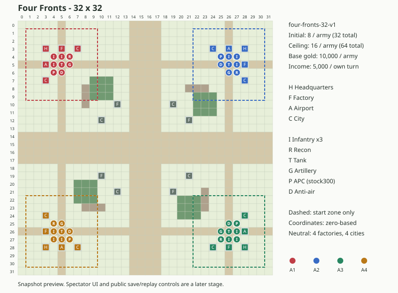

# v1.5.12：専用32盤面・初期条件・部隊上限

2026-11-13 JST。固定マップ「四方の前線」のマップ/初期条件/上限APIまでを追加。開始メニュー・観戦画面・公開用保存操作は次段階。

## 選定と測定条件

**各軍16・合計64部隊を採用する。** 初期8部隊に対し、8枠は増産余地なし、12枠は余地4、16枠は余地8。比較最大の16枠で合法な処理と取消が予算内で成立し、増産余地を確保できるため選んだ。端末の限界値・攻略上の最適値を求めた比較ではない。

[正式事前検証](https://github.com/kumakumapon/MiniStr/actions/runs/43433815537)成功。計測元は[`0d0a14e3ade690d2458bb5e210bb812e545b69c6`](https://github.com/kumakumapon/MiniStr/commit/0d0a14e3ade690d2458bb5e210bb812e545b69c6)。後続の記録/プレビューとブラウザの検査強化は、マップ・エンジン・CPUの本体コードを変更しない。

Node条件は満員の開始域と中央接触の2合成盤面×行為軍4×normal/hard×均衡方針。各条件1回準備後に5回、候補ごと80件・計240件を測る。決定性・実盤面の合法性・上限維持も確認。CPUと実エンジン適用を分けた。Node v24.22.2 / INTEL(R) XEON(R) PLATINUM 8573C / Linux x64、同一Actions job。

| 上限 / 総部隊 | CPU p50 / p95 / max (ms) | 命令適用 p50 / p95 / max (ms) |
| --- | --- | --- |
| 8 / 32 | 7.891 / 14.713 / 20.14 | 1.509 / 2.546 / 4.16 |
| 12 / 48 | 8.183 / 11.157 / 17.113 | 1.549 / 2.337 / 4.147 |
| 16 / 64 | 8.71 / 11.136 / 18.095 | 1.58 / 1.973 / 4.097 |

候補は8→12→16の固定順でJITや共有runnerの揺れがある。速度順位や勝率/強さの差を判断せず、16枠の絶対予算を判断材料にした。

## 実Worker

各候補16件（2盤面×4軍×2回）を計測し、最初の1件をcold、残る15件をwarmとする。観測作成・通信・返信検証を含む往復時間。各要求2,000ms以内、計64部隊の取消250ms以内を失敗検出境界にした。実機の応答保証値ではない。

| ブラウザ | 上限 / 総部隊 | warm p50 / p95 / max (ms) | cold (ms) |
| --- | --- | --- | --- |
| chromium | 8 / 32 | 17.5 / 32.6 / 32.6 | 81.5 |
| chromium | 12 / 48 | 17.3 / 47.6 / 47.6 | 96.7 |
| chromium | 16 / 64 | 17.8 / 46.1 / 46.1 | 149.9 |
| firefox | 8 / 32 | 25 / 36 / 36 | 102 |
| firefox | 12 / 48 | 26 / 39 / 39 | 102 |
| firefox | 16 / 64 | 23 / 31 / 31 | 88 |
| webkit | 8 / 32 | 24 / 346 / 346 | 109 |
| webkit | 12 / 48 | 21 / 56 / 56 | 69 |
| webkit | 16 / 64 | 16 / 27 / 27 | 185 |

取消は3ブラウザとも0ms表示で境界を満たした。タイマー分解能を含む観測値で、厳密なゼロ時間を意味しない。WebKitの8枠に346msのwarm外れ値があり、原因は切り分けていない。16枠が速いという因果推論に使わず、全値を保持する。

公開マップから96命令、全4軍の進行、schema2の履歴照合も確認。既存3件＋追加2件を3ブラウザで実行し15件成功。最終ソースではWorker作成4/終了4と、返信前に主スレッドのタイマーが動くことの検査も追加し、mainの全E2Eで再確認する。

[集約JSON](v1.5.12/capacity-summary.json)に計測元SHA/runと全候補の集約値を保存。全Node/ブラウザサンプルは同runの`four-army-v1512-precheck-evidence`成果物へ保存した。再実行は`npm run four-army:capacity -- test-results/four-army-capacity-node.json`と`npx playwright test tests/e2e/four-army-cpu.spec.ts`。

## 検証・互換性

事前検証は単体1,782件/179ファイル、lint・format・TypeScript6のテストを含む型検査、build、実Worker15件が成功。coverage（statement/branch/function/line）は74.01/73.28/79.67/77.45%、AIは98.60/96.36/98.97/99.66%。既存閾値・CI/Pages公開条件は維持。公開前に最終mainの全ゲート・Pages・Releaseを確認する。

追加17テストは固定初期条件、全24手番順の初回収入、全開始部隊から施設への地上到達性、32盤面のCPU判断、不正区域/上限、全4軍の16→17生産拒否、搭載の計数・合流後の再生産、旧schema1/新schema2の履歴照合と改ざん拒否、通常2軍/研究への誤読込拒否を含む。

ローカルのVitest3.2.7による関連59件、TypeScript5.9.3のsrc型検査、Node24.19の直接実行は補助検証として区別する。プレビューはsnapshotから生成した図で、観戦画面のスクリーンショットではない。

## 残る公開判定

32/軍・総128は比較対象外。内部計算境界を公開上限へ転用しない。対称性・到達性・初回収入の一致で対局の公平性を保証しない。全手番順/配置/seed/方針/難易度の対局結果、同じ総部隊数の2軍/4軍のCPU時間・実入力応答・実機、2時間/4時間のメモリは後続。

次は①開始メニュー・観戦画面、②公開用保存/JSON/長い履歴・CPU設定/リプレイ/バックアップ、③公平性・性能・旧2軍退行を含む公開判定。旧4全体はマップ/初期条件/上限までの部分完了を維持する。
