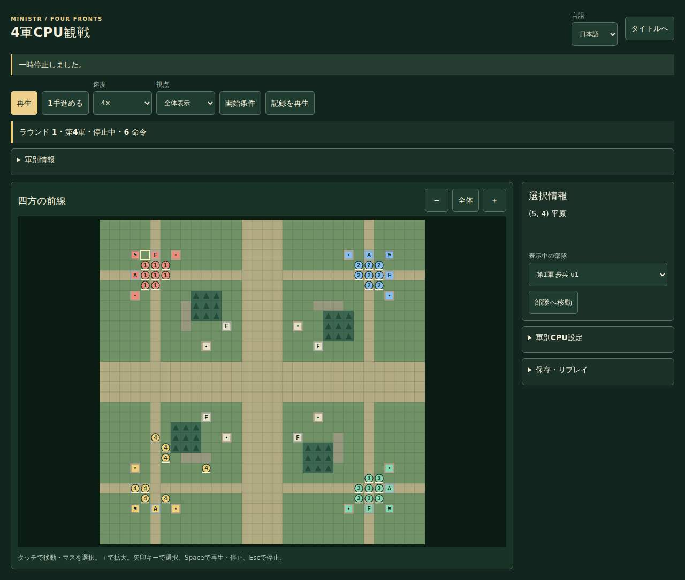
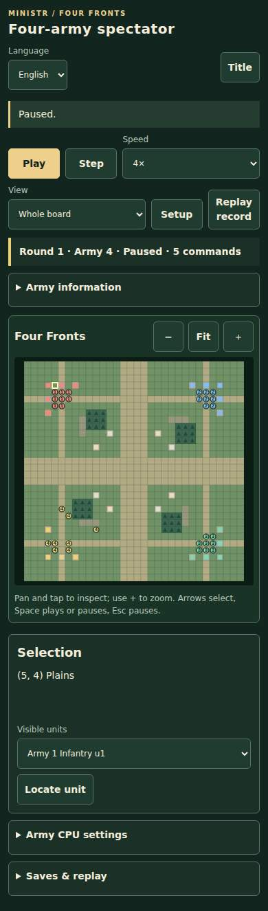

# v1.5.13 screen review

Captured with Chromium from final implementation source `2ff87faafa0146ea4d0fb12536c14db0ee1b660f` in [read-only precheck](https://github.com/kumakumapon/MiniStr/actions/runs/43459096424). Desktop 1280px Japanese and mobile 390px English, reduced motion, fixed demo seed42. The source was merged as `633a64a15daccd913ec926853c02f50ecafc2bad` in PR #297 after the main-element compatibility fix.

Canvas and DOM were visually inspected. All four corners fit; the controls and folded tools do not overlap the board. These browser screenshots are not physical-device or long-duration evidence.

