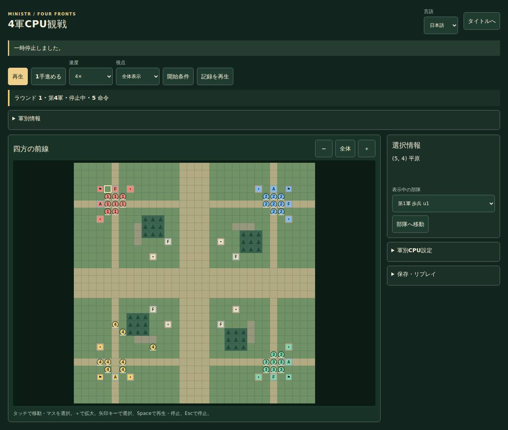
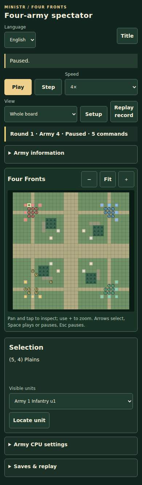

# v1.5.14 ブラウザ実測・画面

公開対象main `83d8c835c62061a1ac9dc719407f4af28fe39fb3`、PR最終source `a905f0902d06a45cf59582ef22bcf1495af55e69`。計測はGitHub-hosted Ubuntu x64 / Node24 / npm11.9.0、lock固定、実モジュールWorkerとPlaywrightのネイティブ3ブラウザを使用した。物理モバイルではない。

計測開始時の実装dd0c1b5から最終sourceまで、配布するゲーム・UI実装は同一。後続差分は比較補助とテストのみ。最初のCPU比較は同じオブジェクトの再利用で2軍側にcacheが残るため採用せず、各判断に新しいDTOを用意して再測定した。cloneは計測外、warmup5回後に20回、2軍/4軍の順序を交互にした。

初回事前runは単体/UIの時間超過を含み、全体成功とは扱わない。重複した再生を削減し、非同期完了の待ち方と未使用importを修正した。以下の継続測定は成功した各endurance jobのみを採用する。最終の最大長試験では、JSONが実際に1MBを超えること、exportが保存原本と完全一致すること、復元候補の言語jaを取消後に反映しないことも確認した。既存のCI/Pagesゲートと通常E2E30秒予算・retryは維持。

## 最大65,536命令

| ブラウザ | 読込/全検証(s) | 保存/全検証(s) | 再生を開く(ms) | 同一記録の再export(ms) | 位置移動6回の最大(ms) | 出典 |
| --- | ---: | ---: | ---: | ---: | ---: | --- |
| chromium | 53.04 | 54.24 | 116.2 | 78.0 | 2904.4 | [job](https://github.com/kumakumapon/MiniStr/actions/runs/43501658648/job/132148721828) |
| firefox | 127.67 | 129.19 | 177.9 | 102.7 | 4600.3 | [job](https://github.com/kumakumapon/MiniStr/actions/runs/43501658648/job/132148721936) |
| webkit | 76.10 | 71.10 | 357.9 | 177.3 | 3533.6 | [job](https://github.com/kumakumapon/MiniStr/actions/runs/43501658648/job/132148721813) |

入力JSONは3,703,113 bytes、圧縮保存は440,383 bytes。最大長の読込・名前付き保存・ページ再読込からの復元・再生終端/先頭/遠距離移動・export・バックアップ取消を実画面で確認。保持する再生状態は最大42、終了後Workerは0。完全な履歴検証には表の待ち時間があり、短い入力応答やcacheによる再exportと区別する。8MBはファイル上限であり、端末の保存領域を保証する値ではない。

## 390px・10分の実対局

| ブラウザ | 秒 | 適用命令 | 停止応答p95/最大(ms) | 終了後Worker | 出典 |
| --- | ---: | ---: | ---: | ---: | --- |
| chromium | 600.59 | 4915 | 14.0 / 14.0 | 0 | [job](https://github.com/kumakumapon/MiniStr/actions/runs/43499165835/job/132140103897) |
| firefox | 600.68 | 4581 | 20.0 / 20.0 | 0 | [job](https://github.com/kumakumapon/MiniStr/actions/runs/43499165835/job/132140103822) |
| webkit | 600.83 | 4830 | 10.0 / 10.0 | 0 | [job](https://github.com/kumakumapon/MiniStr/actions/runs/43499165835/job/132140103701) |

毎分、実pointer入力の停止・状態保持・Worker取消・視点変更・pagehide/pageshow・再開を確認。pagehide/pageshowは合成イベントで、OSによる実際の背景移行ではない。停止はpointerdownから処理後のrequestAnimationFrameまでの10標本。Chromiumの明示GC後heapは1分目5.47MiB→10分目6.45MiB（最大6.45MiB）。履歴が増える区間の有限測定であり、リークが存在しない証明ではない。Firefox/WebKitはheap値を取得していない。

## 同じ総部隊数のCPU比較

32×32の合成局面。総32/64部隊（4軍は各8/16、2軍は各16/32）をhome/frontへ置く。異なるCPUアルゴリズムの判断時間比較であり、同じ対局・同じ敵数・勝率の比較ではない。以下は各20標本のp95、ms。

| 総部隊 | 配置 | 難易度 | Chromium 2軍/4軍 | Firefox 2軍/4軍 | WebKit 2軍/4軍 |
| --- | --- | --- | ---: | ---: | ---: |
| 32 | home | normal | 2.80 / 8.10 | 2.00 / 11.00 | 3.00 / 13.00 |
| 32 | home | hard | 1.80 / 6.50 | 2.00 / 11.00 | 2.00 / 9.00 |
| 32 | front | normal | 2.80 / 9.60 | 2.00 / 16.00 | 1.00 / 16.00 |
| 32 | front | hard | 1.00 / 19.70 | 2.00 / 14.00 | 1.00 / 9.00 |
| 64 | home | normal | 1.50 / 10.40 | 3.00 / 11.00 | 2.00 / 10.00 |
| 64 | home | hard | 1.10 / 7.70 | 2.00 / 17.00 | 1.00 / 9.00 |
| 64 | front | normal | 1.10 / 12.30 | 2.00 / 14.00 | 1.00 / 8.00 |
| 64 | front | hard | 1.00 / 10.00 | 3.00 / 14.00 | 1.00 / 8.00 |

[CPU比較job](https://github.com/kumakumapon/MiniStr/actions/runs/43500674307/job/132145299429)・[4軍画面/既存CPU/バックアップ69件](https://github.com/kumakumapon/MiniStr/actions/runs/43500674307/job/132145298957)。

## 画面の目視確認

1280px/日本語と390px/英語を実ブラウザで撮影し、盤面・部隊番号・停止/速度/視点・保存導線の重なりや横はみ出しを確認した。狭幅ではページを縦にスクロールする。

## 再現と残件

`npm ci`・`npm run build`・`npx playwright install --with-deps chromium firefox webkit` の後、`npm run test:four-army-endurance`。固定88条件は `npm run four-army:assessment -- 0 12 output.json` のshard番号0〜11で再現する。

[全ネイティブ実測JSON](native.json)・[88条件と集計](https://github.com/kumakumapon/MiniStr/blob/83d8c835c62061a1ac9dc719407f4af28fe39fb3/docs/reviews/v1.5.14/fairness.json)。最終main品質・実デプロイ・正式タグ/Releaseの照合はPR #302とIssue #264/#275へ記録する。

次は未決着/第3軍勝利差の原因特定と限定CPU改善、物理端末のタッチ/支援技術と2/4時間の継続測定。10分の自動試験や最大記録の検証を、全端末の公平性/長期性能保証へ置き換えない。
