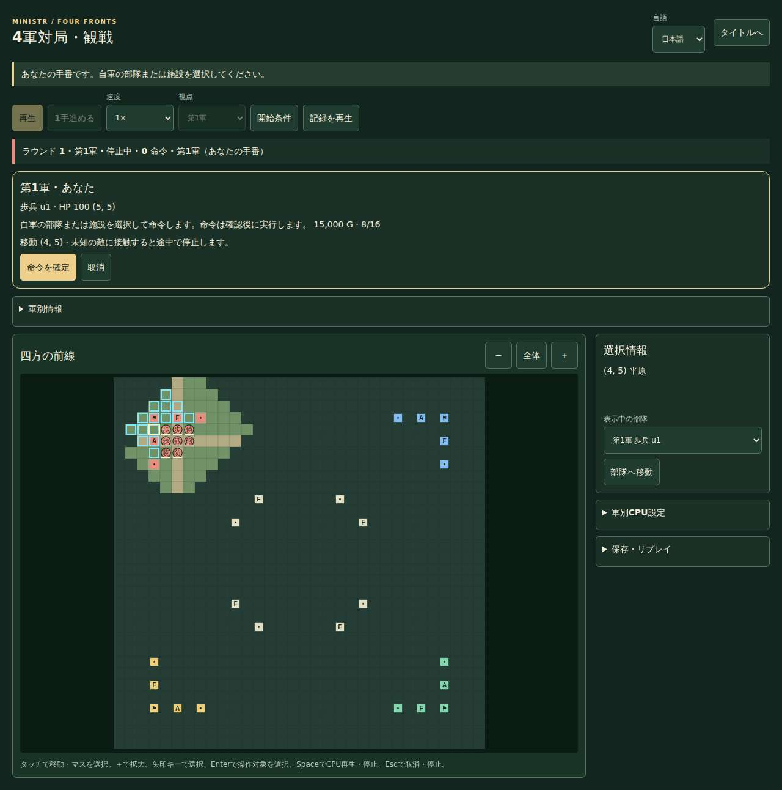
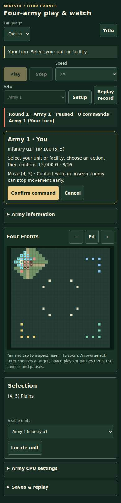
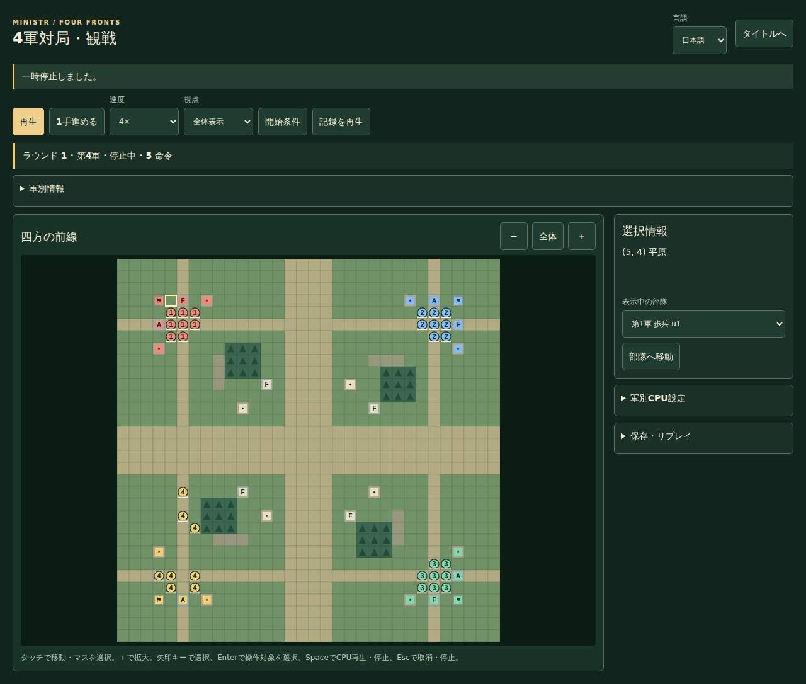
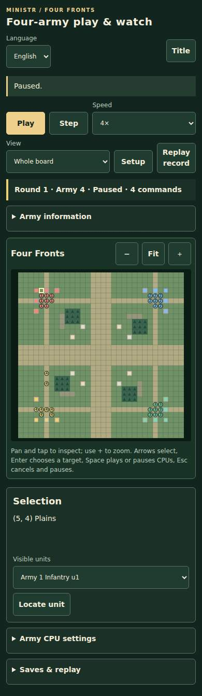

# v1.5.17 実画面・検証の出典

[正式QA run](https://github.com/kumakumapon/MiniStr/actions/runs/43554437810)、[全件/配布UI](https://github.com/kumakumapon/MiniStr/actions/runs/43554437810/job/132323978379)、[実ブラウザー108件](https://github.com/kumakumapon/MiniStr/actions/runs/43554437810/job/132323978554)。診断コミット `1e617d92860a38047c06b259751bb0739c487c53` のゲーム/画面/テストは実装ソース `239fcd9639dfe3ad4559845cb652dbb48e744cec` と一致し、追加は読取専用QA workflowのみ。

[検証メタデータ](verification.json)。Linux上のChromium/Firefox/WebKit。390pxは画面幅の確認で、物理iPhone/Androidの検証ではない。

## 参加対局・PC1280px / 日本語

## 参加対局・390px / 英語

## 既存CPU観戦

