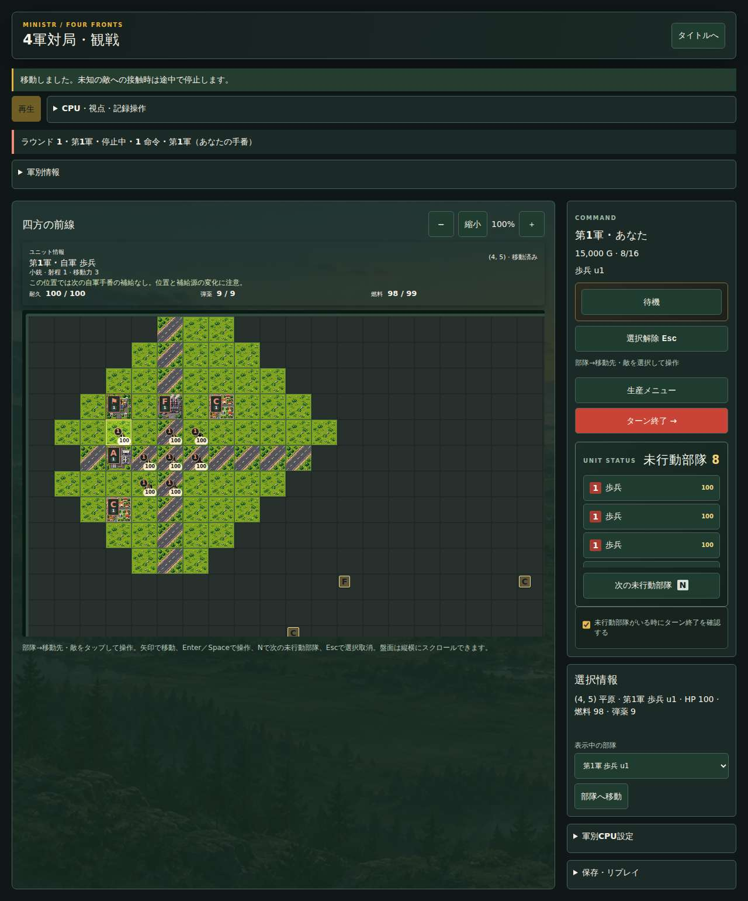
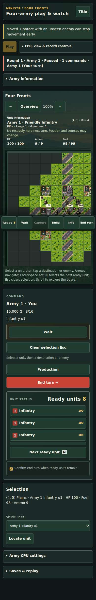

# v1.5.18 4軍UI統一レビュー

4軍の画面と操作を2軍の盤面・部隊画像・カード・入力処理へ統一する。[仕様](../four-army-ui-parity.md)。ゲーム規則、CPU判断版、保存schemaと互換読込、公開条件は変更していない。

実装ソース `d78a00996947fffe825fdce2f0f0ab5410023bb7`、診断ソース `c6c0bf1bd018ab09d5b3a6834b0b51c6999c432c`。診断ブランチの差分は読取専用のQA workflowだけ。製品ブランチのCI／Pagesの条件・権限・閾値・timeout/retryを変更していない。

## 検証

| 検証 | 結果 | 出典 |
| --- | --- | --- |
| lockfile依存・Node24/npm11.9.0、CI条件回帰、lint、整形、テストを含む型検査、build | 成功 | [正式QA](https://github.com/kumakumapon/MiniStr/actions/runs/43571614364/job/132377021766) |
| 全単体テスト | 1,850件／194ファイル成功 | 同上 |
| coverage（statement/branch/function/line） | 75.22／74.36／80.28／78.75%・全体と領域別ゲート成功 | 同上 |
| 配布bundle UI | 67件／10ファイル成功 | 同上 |
| 4軍操作・既存観戦・実Worker・保存／バックアップの実ブラウザー | 111件・Chromium／Firefox／WebKit成功 | [実ブラウザーQA](https://github.com/kumakumapon/MiniStr/actions/runs/43571614364/job/132377021945) |
| private-sessionリンク・差分検査 | 成功 | ローカルと通常main CIで再検証 |

全4担当軍でPC1280px／日本語と390px／英語を確認。部隊選択・Esc取消・直接移動・待機・敵3軍後の入力待ち、担当軍付き保存／停止再開、リプレイを検証した。主／副武器の予測と指定・移動時の武器選択保持、生産、搭載・降車、脱落後観戦、勝利後の入力停止、旧観戦と参加保存の相互読込も確認。ネイティブの矢印／Enter／Space／N／Home／End／Esc操作も各ブラウザーで検証した。

正式な依存環境の結果と区別し、ローカル補助環境でも関連31件、テストを含む型検査、リンク・差分検査が成功。診断のブラウザー並列数は通常CIと同じ2。公開前には、通常main CIの全E2E・地形比較33件・Node22.13互換と同一SHAのPages配信を再検証し、正式タグ・配信bundleのversion/SHAを照合する。公開実績は[PR #311](https://github.com/kumakumapon/MiniStr/pull/311)とReleaseに記録する。

## 検出した問題への対応

最初のQAはDOM盤面の再描画増加による2件の5秒制限超過と、390pxで情報カードが開く際の盤面移動による12件の押下失敗を検出した。盤面モデルの変更時だけ描画し、設定変更時の中間描画とID検索の全走査を減らした。押下中のフォーカスではカードの描画を遅らせ、クリック先を保持する。WebKitの連続操作時間も確認し、カードと制御要素を保持して更新を絞り、通常CIと同じ並列条件で全件を検証した。テスト削除・skip追加、時間制限の変更で回避していない。

## 実画面

Chromiumの公開UI操作後をそのまま記録した。[機械可読の検証情報](v1.5.18/verification.json)。全ページ画像の固定操作バーは撮影時のスクロール位置に対応する。

### PC1280px・日本語

### 390px・英語

## 継続する4軍残件

1. 新20打切り条件の個別診断・延長評価と、未使用seed・開始順を含むCPU公平性。
2. 物理PC／スマートフォンでの2／4時間連続運転、長期保存・再開とメモリ／応答の実測。
3. 人間参加の実戦による難易度と操作性の評価・調整。

自動ブラウザーの390px表示を物理端末・タッチ・支援技術の検証とは扱わない。CPU比較の再実施や既知の公平性課題の解消も、本UI改修では主張しない。
